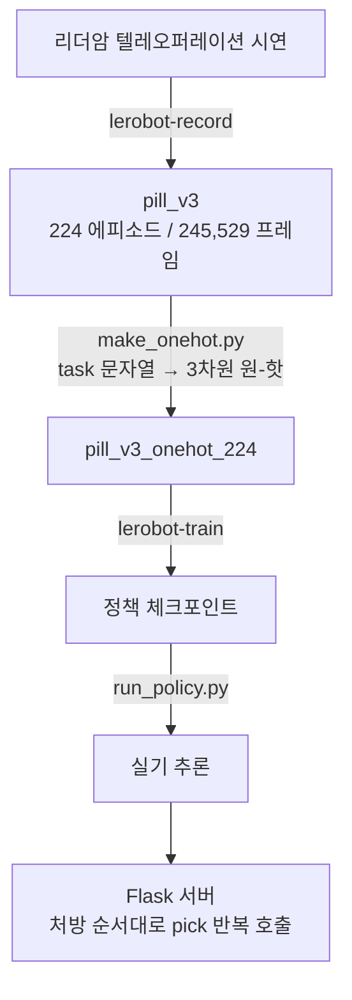

# OMX 알약 자동 조제 — 기술 명세

**AI 기반 대학병원 환자 안내 및 약국 자동 조제 로봇 시스템** / OMX 조제 파트

| 항목 | 내용 |
|---|---|
| 목적 | 여러 색 알약이 섞인 트레이에서 처방된 색만 순서대로 골라 약통에 담습니다 |
| 방식 | 모방학습(Imitation Learning) — 리더암 텔레오퍼레이션 시연을 학습합니다 |
| 데이터 | 224 에피소드 / 245,529 프레임 |
| 현재 상태 | 색별 정책 3개로 실기 동작을 확인했습니다. 단일 정책 목표 조건화는 **다섯 가지 방식을 검증했으나 미해결**입니다 |

---

## 1. 시스템 구성

### 1.1 하드웨어

| 구성 | 사양 | 비고 |
|---|---|---|
| 로봇 | OpenManipulator-X 팔로워 + 리더 암 | dynamixel-sdk 로 제어합니다 |
| 카메라 | `top` 고정 오버헤드, `wrist` 그리퍼 상단 | 640×480 MJPG 30fps |
| 연산 | NVIDIA RTX 4060 Laptop (VRAM 8GB) | 배치 크기 8, Mixed Precision 필수입니다 |
| 트레이 | 검은 매트, 배치 영역 211×132mm | 5×4 격자(칸당 42×33mm)로 관리합니다 |

카메라 장치 경로는 재부팅 시 번호가 바뀌므로 `/dev/v4l/by-id/` 고정 경로를 사용합니다.

### 1.2 소프트웨어

| 구성 | 버전 · 위치 | 비고 |
|---|---|---|
| OS | Ubuntu 24.04.4 LTS | |
| 프레임워크 | LeRobot v0.4.4 (`~/il_ws/src/lerobot`, editable) | 버전을 고정했습니다. 로컬 패치가 있어 업그레이드 시 유실됩니다 |
| 가상환경 | `~/venv/il` | |
| 정책 | ACT (chunk 100), SmolVLA (비교군) | |
| 조작 화면 | Flask + Server-Sent Events | 환자 정보 입력부터 조제 진행 표시까지 담당합니다 |

### 1.3 데이터 파이프라인



---

## 2. 설계 원칙

### 2.1 모델과 처방 로직의 분리

모델은 **"지정된 알약 하나를 집는 것"** 만 학습합니다. 처방 조합(예: 빨강 + 노랑)을
순서대로 처리하는 로직은 모델이 아니라 상위 서버가 담당합니다.

```
모델          π(행동 | 관측)              — 알약 하나 집기
Flask 서버    for color in 처방: pick(color)  — 조합과 순서
```

이 분리에는 두 가지 이점이 있습니다.

- 처방표를 변경해도 재학습이 필요하지 않습니다.
- 모델의 학습 목표가 단순해져 적은 데이터로 수렴합니다.

### 2.2 배치 랜덤화

에피소드마다 알약의 위치와 각도를 무작위로 배치합니다. 위치를 고정하면 모델이
화면을 참조하지 않고 위치를 암기하는 문제가 발생합니다(트러블슈팅 A-1 참조).

배치 영역은 `area.json`(x 91~415, y 102~305)으로 고정하고, 5×4 격자와 8방향
각도를 난수로 조합한 배치표를 사용합니다.

---

## 3. 정책 아키텍처 — ACT

**Zhao et al., "Learning Fine-Grained Bimanual Manipulation with Low-Cost Hardware", RSS 2023**

ResNet18 백본으로 카메라 2대의 영상을 인코딩하고, 트랜스포머 인코더·디코더로
행동 시퀀스를 출력합니다.

### 3.1 입력 토큰 구성

```
480×640 입력 → ResNet18 (stride 32) → 15×20 특징맵 = 300 토큰 / 카메라
```


목표가 전체 토큰의 0.17%에 불과하다는 점이 단일 정책 목표 조건화 실패의
첫 번째 원인으로 확인되었습니다(트러블슈팅 A-2).

### 3.2 주요 구성 요소

**Action Chunking**
한 번의 추론으로 100스텝(약 3.3초)의 행동을 예측합니다. 스텝 단위 예측에서
발생하는 오차 누적과 사람 시연의 다중모드성 문제를 완화합니다.

**CVAE (조건부 변분 오토인코더)**
학습 시 정답 행동 시퀀스를 32차원 잠재변수 `z` 로 압축하여 시연의 편차를 흡수합니다.
추론 시에는 `z = 0`(사전분포 평균)을 사용합니다.

> 이 구조가 단일 정책 목표 조건화를 무력화하는 두 번째 원인으로 확인되었습니다(트러블슈팅 A-3).

**Temporal Ensembling**
겹치는 청크들을 지수가중 평균하여 청크 경계에서 발생하는 불연속을 제거합니다.
계수는 0.01을 사용합니다.

---

## 4. 학습 방식 두 가지

동일한 ACT 아키텍처를 두 가지 방식으로 적용했습니다. 차이는 **"어느 알약을 집을지를
모델에 어떻게 전달하는가"** 입니다.

| 구분 | **A. 색별 정책 3개** | **B. 원-핫 단일 정책** |
|---|---|---|
| 정책 개수 | 3개 (빨강 · 초록 · 노랑) | 1개 |
| 목표 전달 | 정책 교체 (목표 입력 없음) | 3차원 원-핫 입력 + FiLM |
| 학습 데이터 | 색별 해당 에피소드만 | 전체 224 에피소드 |
| 학습량 | 색당 40K 스텝 (9.0 에폭) | 40K ~ 200K 스텝 |
| 파라미터 | 51.6M × 3 | 51.6M |
| **자기색 대비** | **3.00 ~ 5.45** | 1.00 ~ 1.22 (기준선 1.02) |
| **실기 동작** | **정상 — 지정된 색을 집어 담습니다** | 지시를 무시하고 임의의 알약을 집습니다 |
| 시연 적용 | 적용 | 미적용 |


### 4.1 방식 A — 색별 정책 3개 (현재 적용)

목표를 입력으로 전달하지 않습니다. 각 정책이 자기 색만 학습한 상태이므로,
"빨강을 집어라"는 지시는 **빨강 정책을 로드하는 것**으로 표현됩니다.

| 색 | 정책 | 실기 보정값 | 보정 좌표계 |
|---|---|---|---|
| 빨강 | `act_v3_red29` | 깊이 +9, 좌우 +5, 높이 −1 | 반경 (`--radial-offset`) |
| 초록 | `act_v3_green40k` | 깊이 +4, 좌우 −2 | 책상 (기본값) |
| 노랑 | `act_v3_yellow40k` | 좌우 +9 | 반경 (`--radial-offset`) |

정책마다 학습 데이터와 수렴 지점이 다르므로 편향도 다르게 나타납니다.
따라서 보정값을 색별로 따로 관리합니다.

#### 데이터 확충 후 재학습 (224 에피소드)

수집을 마친 224 에피소드로 세 정책을 다시 학습했습니다. **학습 조건은 기존과
동일하게 두고**(ACT, 9에폭, 배치 8, 기본 증강) 데이터만 2.4배로 늘렸습니다.
변경 항목을 하나로 제한해야 결과의 귀속이 가능하기 때문입니다.

| 색 | 신규 정책 | 자기색 대비 | 자기색 오차 |
|---|---|---|---|
| 초록 | `act_green_224/087502` | 3.72 → **4.77** (+28%) | 0.926 → **0.640** (−31%) |
| 노랑 | `act_yellow_224/060000` | 3.96 → **4.61** (+16%) | 0.762 → **0.646** (−15%) |
| 빨강 | `act_red_224/090000` | 2.79 → **3.00** (+8%) | 1.042 → **0.743** (−29%) |

세 색 모두 색 구분 능력과 궤적 정확도가 함께 개선되었습니다. 위 값은 전부
`probe_percolor.py` 로 동일하게 측정한 것이며, 측정 방식이 다른 값(3.26 ~ 5.45)과
직접 비교하지 않습니다.

**최종 체크포인트가 최선이 아닙니다.**

| 색 | 학습 경과 | 정점 |
|---|---|---|
| 초록 | 40K 4.24 → 87K 4.77 | 최종 |
| 노랑 | 60K **4.61** → 70K 4.21 → 89K 3.81 | 6에폭 |
| 빨강 | 80K 2.60 → 90K **3.00** → 99.6K 2.53 | 9에폭 직전 |

색마다 최적 학습량이 달라 두 색은 마지막 구간에서 하락했습니다. 따라서 배포
대상 체크포인트는 **학습 종료 시점이 아니라 체크포인트별 측정으로 선정합니다.**

현재 실기 검증 전이므로 배포 정책은 기존 3개를 유지하고 있습니다.
오프라인 지표와 실기 결과가 어긋난 사례가 있어(트러블슈팅 B 계열), 실기 확인을
거친 뒤 교체합니다.

#### 보정 좌표계

정책의 출력에 더하는 보정값을 **어느 기준 방향으로 해석할지** 결정합니다.
두 방식은 팔이 정면(pan = 0)일 때만 일치하며, 좌우로 회전할수록 차이가 커집니다.

| 좌표계 | 해석 | 예: `깊이 +9` |
|---|---|---|
| **반경** (`--radial-offset`) | 팔이 뻗은 방향 기준 | 팔이 향한 쪽으로 9mm |
| **책상** (기본값) | 책상에 고정된 방향 기준 | 팔의 방향과 무관하게 책상 안쪽으로 9mm |

책상 좌표계는 현재 `shoulder_pan` 각도로 보정 벡터를 분해합니다.

```python
th = np.radians(pan_deg)
radial     = lateral_mm * sin(th) + depth_mm * cos(th)   # 팔 반경 방향 성분
tangential = lateral_mm * cos(th) - depth_mm * sin(th)   # 접선(좌우) 방향 성분
```

**책상 좌표계를 도입한 이유**: 실기에서 관찰되는 편향은 카메라와 작업대의 정합
오차에서 발생하므로, 팔의 자세가 아니라 **책상에 고정된 방향**을 따릅니다.
반경 기준으로 보정하면 정면에서 맞춘 값이 좌우 위치에서 어긋납니다
(2026-08-05 실기 관찰: 오른쪽에서 맞춘 보정값이 왼쪽에서 크게 빗나감).

현재 빨강과 노랑은 반경 기준으로 보정값을 산출해 두었으므로 해당 방식을 유지하고
있습니다. 책상 기준으로 전환하려면 보정값을 다시 측정해야 합니다.

**보정 적용 시점**: 보정은 접근 진행도에 비례하여 적용합니다(홈 자세 0%,
파지 자세 100%). 상수로 적용하면 홈 자세부터 틀어진 상태로 출발하여 관절이
꺾입니다(트러블슈팅 E-4 참조).

**장점**
- 목표 조건화 문제가 구조적으로 발생하지 않습니다. 정책이 자기 색만 알기 때문입니다.
- 색당 30개 수준의 적은 데이터로도 동작합니다.

**한계**
- 색을 추가할 때마다 학습을 한 번 더 수행해야 합니다.
- 정책 3개와 보정값 3벌을 별도로 관리해야 합니다.
- 색이 바뀔 때마다 정책을 다시 로드하며, 이때 카메라도 재연결합니다.

**다중 알약 조제 절차**
Flask 서버가 처방의 색 순서대로 `pick()` 을 호출합니다. 모델은 조합을 인지하지 않습니다.

### 4.2 방식 B — 원-핫 단일 정책 (설계 원안, 미해결)

정책 하나가 `π(행동 | 관측, 목표)` 형태로 세 색을 모두 처리하는 방식입니다.
색이 늘어나도 정책이 하나로 유지되므로 확장성이 우수합니다.

구현은 두 단계로 구성됩니다.

1. **원-핫 부착** — `make_onehot.py` 가 녹화된 task 문자열을 3차원 벡터로 변환하여
   `observation.environment_state` 피처로 부착합니다.
2. **FiLM 주입** — LeRobot ACT 에 패치를 적용하여 목표가 시각 특징 512채널 전체를
   변조하도록 합니다.

**측정 결과**

| 조건 | 자기색 대비 | 비고 |
|---|---|---|
| 원-핫 토큰만 | 1.00 | 목표를 완전히 무시합니다 |
| 원-핫 + FiLM (96 에피소드) | 1.33 | 학습에 사용한 장면 기준입니다 |
| 원-핫 + FiLM (96 에피소드) | **1.03** | **미학습 장면 기준. 기준선과 동일합니다** |
| 원-핫 + FiLM (224 에피소드) | 1.22 | 80K 스텝 이후 정체합니다 |
| 원-핫 + FiLM, CVAE 제거 | 1.13 | 우회 경로를 차단해도 개선되지 않았습니다 |
| — 기준선 | 1.02 | 화면 참조 없이 색별 평균 궤적만 출력하는 예측기 |

미해결 사유는 트러블슈팅 A-2 · A-3 에 정리했습니다. 요약하면 **모델이 목표를
참조하지 않고도 학습 손실을 낮출 수 있는 경로를 반복적으로 찾아냈습니다.**

**해결 시 기대 효과**
- 정책이 하나로 유지되어 색 추가가 데이터 추가만으로 가능해집니다.
- 색 전환 시 정책 재로드가 불필요하여 조제 시간이 단축됩니다.
- 원-핫을 언어 지시(SmolVLA)로 확장하기 용이합니다.

---

## 5. 목표 조건화 구현 (방식 B)

### 5.1 원-핫 부착

ACT 에는 토크나이저와 언어 인코더가 없어 task 문자열을 읽지 못합니다. 목표가
입력될 수 있는 경로는 `observation.environment_state` 하나이며, `lerobot-record`
는 이 피처를 생성하지 못합니다. 따라서 녹화 완료 후 별도로 부착합니다.

```python
COLORS  = ["yellow", "red", "green"]         # 순서 고정. 변경 시 기존 정책이 다른 색을 집습니다
FEATURE = "observation.environment_state"    # 이 이름이어야 FeatureType.ENV 로 분류됩니다
NAMES   = [f"goal_{c}" for c in COLORS]

onehot = {task_index: np.array([1,0,0] / [0,1,0] / [0,0,1], dtype=np.float32)}

add_features(
    ds,
    {FEATURE: (value_fn, {"dtype": "float32", "shape": [3], "names": NAMES})},
    output_dir=out_root, repo_id=out_repo,
)
```

**주의 사항**

- 키 이름이 다르면 `FeatureType.STATE` 로 분류되어 관절값과 함께 정규화됩니다.
- `ENV` 는 ACT 의 정규화 매핑에 없어 IDENTITY 로 처리되므로 0/1 값이 그대로 전달됩니다.
- `add_features` 는 원본을 수정하지 않고 새 데이터셋으로 복사합니다. 영상은 재인코딩
  없이 복사되므로 수 분 내에 완료됩니다.

### 5.2 FiLM (Feature-wise Linear Modulation)

**Perez et al., "FiLM: Visual Reasoning with a General Conditioning Layer", AAAI 2018**

목표를 토큰 하나로 전달하면 이미지 토큰 600개에 묻힙니다. FiLM 은 목표 벡터로부터
스케일 γ 와 시프트 β 를 생성하여 시각 특징 512채널 전체를 변조합니다.

```
f' = (1 + γ(goal)) · f + β(goal)
```

```python
# configuration_act.py
film_conditioning: bool = False      # 기본값 비활성. 기존 체크포인트와 호환됩니다

# modeling_act.py — 모듈 정의
self.film = nn.Sequential(
    nn.Linear(env_state_dim, dim_model), nn.ReLU(),
    nn.Linear(dim_model, 2 * dim_model),
)
nn.init.zeros_(self.film[-1].weight)   # γ≈0, β≈0 에서 출발하여 항등변환으로 시작합니다
nn.init.zeros_(self.film[-1].bias)

# modeling_act.py — forward
gb = self.film(batch[OBS_ENV_STATE])
gamma, beta = gb.chunk(2, dim=-1)
cam_features = (1.0 + gamma[:, :, None, None]) * cam_features + beta[:, :, None, None]
```

**구현 시 확인 사항**

- `env_state` 토큰은 제거하지 않고 유지합니다. 제거하면 위치 임베딩 길이가
  602와 603으로 불일치하여 오류가 발생합니다. FiLM 은 추가 경로로 동작합니다.


- 실측 결과 γ 의 평균 절대값은 0.24(최대 1.01), 목표 간 γ 차이는 최대 1.58 로
  **변조 자체는 정상 동작합니다.** 조건화 실패의 원인은 FiLM 이 아닙니다.

### 5.3 추론 시 목표 주입

로봇은 `observation.environment_state` 를 생성할 수 없으므로, 추론 스크립트가
task 문자열로부터 생성하여 관측에 삽입합니다.

```python
def goal_values(meta, task):
    ft = meta.features.get("observation.environment_state")
    if ft is None:
        return {}
    color = color_of_task(task)
    # names 순서를 그대로 따르며 순서를 가정하지 않습니다
    return {name: (1.0 if name == f"goal_{color}" else 0.0) for name in ft["names"]}

obs.update(goal_values(meta, task))
```

`build_dataset_frame` 이 피처의 `names` 를 키로 관측 딕셔너리에서 값을 조회하므로,
이름을 맞춘 값만 삽입하면 원-핫이 구성됩니다.

> **제약**: `lerobot-record` 기반 평가 스크립트로는 목표 조건화 정책을 평가할 수
> 없습니다. 해당 경로에는 관측에 값을 삽입할 지점이 없습니다. 평가는
> `run_policy.py` 로 수행합니다.

---

## 6. 학습 설정

### 6.1 공통 설정

| 항목 | 값 | 근거 |
|---|---|---|
| 배치 크기 | 8 | VRAM 8GB 상한입니다 |
| Mixed Precision | 사용 | 배치 8을 확보하기 위해 필요합니다 |
| 이미지 증강 | 밝기 · 대비 · 선명도 | 색상(hue)과 affine 은 제외합니다(트러블슈팅 A-4) |
| 저장 주기 | 10,000 스텝 | 학습 중 지표 추이를 관찰하기 위함입니다 |

### 6.2 재현 명령

**방식 A — 색별 정책**

```bash
# 색별 에피소드만 선택하여 학습합니다
lerobot-train \
  --dataset.repo_id=1unasy/pill_v3 \
  --dataset.episodes="[해당 색 에피소드 번호 목록]" \
  --dataset.image_transforms.enable=true \
  --policy.type=act --policy.device=cuda --policy.use_amp=true \
  --batch_size=8 --steps=40000 --save_freq=10000 \
  --output_dir=train/act_v3_red --policy.push_to_hub=false
```

**방식 B — 원-핫 단일 정책**

```bash
python make_onehot.py --repo-id 1unasy/pill_v3 --out-repo-id 1unasy/pill_v3_onehot_224

lerobot-train \
  --dataset.repo_id=1unasy/pill_v3_onehot_224 \
  --dataset.image_transforms.enable=true \
  --policy.type=act --policy.film_conditioning=true \
  --policy.device=cuda --policy.use_amp=true \
  --batch_size=8 --steps=200000 --save_freq=10000 --num_workers=16 \
  --output_dir=train/act_film_224 --policy.push_to_hub=false
```

> 개별 증강 항목의 가중치는 CLI 로 변경할 수 없습니다
> (`--dataset.image_transforms.tfs.hue.weight=0` 은 인식되지 않습니다).
> `tfs` 전체를 JSON 문자열로 전달해야 합니다.

### 6.3 에폭 정렬

비교 실험에서는 스텝이 아니라 **에폭**을 맞춥니다. 스텝만 맞추면 데이터 규모가
다른 조건 간에 노출량이 달라져, "목표를 무시해서 실패한 것"과 "덜 학습해서 실패한 것"이
구분되지 않습니다.

```
에폭 = 스텝 × 배치 크기 ÷ 전체 프레임 수
```


---

## 7. 평가 지표

실기 평가는 시간이 많이 소요되므로, 체크포인트만으로 판단할 수 있는 개입형 지표를
설계하여 사용했습니다.

### 7.1 자기색 대비

동일한 관측에 **목표만 변경하여 입력**하고 예측 오차의 비율을 측정합니다.

```
자기색 대비 = (틀린 목표 입력 시 오차) ÷ (올바른 목표 입력 시 오차)
```

| 값 | 해석 |
|---|---|
| 1.00 | 목표를 완전히 무시합니다 |
| **1.02** | **기준선.** 화면 참조 없이 "색 → 해당 색의 평균 궤적"만 출력하는 예측기의 값입니다 |
| 3.26 ~ 5.45 | 색별 정책 3개의 실측값입니다 |

로봇, 추가 데이터, 재학습이 모두 불필요하며 체크포인트만으로 수 분 내에 측정됩니다.
성공률만 보고하는 방식으로는 실패 원인이 "지시 미인식"인지 "정밀도 부족"인지
구분할 수 없으나, 이 지표는 두 경우를 분리합니다.

**기준선의 의미**: 위 1.02는 데이터로부터 직접 계산한 값입니다. 색별로 평균 궤적을
구한 뒤, 각 에피소드를 자기 색 평균과 다른 색 평균에 대해 비교한 결과입니다.
측정값이 이 근처면 화면을 참조하지 않고 색별 사전분포만 사용하고 있다고 판단합니다.

### 7.2 화면 기여도

정책 예측과 실제 목표 위치의 상관에서 관절값만으로 설명되는 부분을 제외한 값입니다.

```
파지 진행률 30% 지점    정책 상관 0.77   관절 상관 0.01   화면 기여 +0.76
```

> **측정 위치 주의**: 파지 직전에서 측정하면 팔이 이미 알약 위에 위치하므로
> 관절값만으로 상관 1.00이 산출됩니다(상태 누출). 파지까지 30% 지점에서
> 측정해야 화면 기여가 분리됩니다.

### 7.3 데이터 검증 기법

| 기법 | 검출 대상 |
|---|---|
| 위상 상관 (Phase correlation) | 카메라 평행이동. 224개 중 어긋난 3개를 픽셀 단위로 식별했습니다 |
| ECC 어파인 정합 | 위상 상관이 검출하지 못하는 배율 · 회전 |
| 픽셀 중앙값 배경 | 에피소드 전 프레임의 중앙값으로 이동 물체를 제거하고 정지 물체만 남깁니다 |
| ffprobe 패킷 수 대조 | 영상 프레임 수와 기록된 에피소드 길이의 일치 여부 |
| 타임스탬프 균일성 | 이미지-행동 쌍의 정렬 (전 구간 0.03333초여야 합니다) |

> **검출기는 정답이 알려진 표본으로 먼저 검증해야 합니다.** "이상 없음"이라는 결과가
> 검출기의 미탐일 수 있습니다. 실제로 최초 작성한 알약 개수 검출기는 노랑을 전혀
> 검출하지 못하여 폐기했습니다.

---

## 8. 실험 결과

| 목표 전달 방식 | 증강 | 스텝 | 에폭 | 자기색 대비 |
|---|---|---|---|---|
| 색별 정책 3개 (목표 입력 없음, 96 에피소드) | ON | 40K | 9.0 | **3.26 ~ 5.45** |
| 색별 정책 3개 (목표 입력 없음, 224 에피소드) | ON | 60 ~ 90K | 9.0 | **3.00 ~ 4.77** |
| 원-핫 토큰 | OFF | 80K | 5.5 | 1.00 |
| 원-핫 토큰 | ON | 40K | 2.8 | 1.00 |
| 원-핫 토큰 | ON | 128K | 9.0 | 1.00 |
| 원-핫 + FiLM (96 에피소드) | ON | 128K | 8.9 | 1.33 (학습) / 1.03 (미학습) |
| 원-핫 + FiLM (224 에피소드) | ON | 100K | 3.3 | 1.22 |
| 원-핫 + FiLM, CVAE 제거 (`use_vae=false`) | OFF | 80K | 2.6 | 1.13 |
| **Diffusion Policy (`global_cond` 주입)** | ON | 100K | 2.4 | **0.97** |
| SmolVLA (언어 지시) | ON | 20K | 1.4 | 1.02 |
| 좌표 목표 (`act_xy_224`) | ON | 150K | 5.3 | 3.68 — **단, 학습 장면 기준. 선택률 51%** |
| 좌표 + 화면 속 표식 (`act_marker2`) | affine OFF | 30K | 1.1 | **선택률 54%** (미학습 장면) |


**해석**

- 색별 정책은 목표 입력이 없으므로 조건화 문제가 발생하지 않으며, 실기에서 정상 동작합니다.
- 원-핫 방식은 증강, 스텝, 에폭, 사전학습 언어모델 중 어느 조건으로도 개선되지 않았습니다.
- FiLM 적용 시 학습 데이터 기준 1.33까지 상승했으나, 미학습 장면에서는 1.03으로
  기준선과 동일했습니다. **해당 상승분은 장면 암기에 의한 것으로 판단됩니다.**
- Diffusion Policy 는 목표를 전 계층에 주입하는 구조임에도 0.97 로, 기준선에
  도달하지 못했습니다. 아래에 별도로 정리합니다.
- 목표 표현을 기호에서 좌표로, 다시 화면 속 표식으로 바꾸어도 **지정 알약 선택률이
  무작위(50%) 수준**이었습니다. §8.2 에 정리합니다.

### 8.1 Diffusion Policy — 주입 강도 가설의 검증

ACT 에서 목표는 인코더 입력 603 토큰 중 1개(0.17%)에 불과합니다. 이것이 정체의
원인이라면, 목표를 더 강하게 주입하는 아키텍처에서는 개선되어야 합니다.

Diffusion Policy 는 관측을 `global_cond` 로 압축하여 **디노이징 U-Net 의 모든
계층에 조건으로 전달합니다.** 목표가 특정 토큰 하나에 갇히지 않는 구조입니다.

| 항목 | 값 |
|---|---|
| 학습 | 100,000 스텝 / 2.44 에폭 / 배치 6 / 11시간 42분 |
| 최종 손실 | 0.008 |
| 구성 | `n_obs_steps` 2, `horizon` 16, `n_action_steps` 8, DDPM 100 스텝 |

**측정 결과 (100K)**

| 색 | 올바른 목표 오차 | 틀린 목표 오차 | 비율 |
|---|---|---|---|
| 노랑 | 0.89 | 0.86 | 0.96 |
| 빨강 | 0.98 | 0.93 | 0.95 |
| 초록 | 0.88 | 0.88 | 1.00 |
| **평균** | | | **0.97** |

세 색 모두 1.00 이하입니다. 틀린 목표를 입력했을 때가 근소하게 더 정확했으며,
이는 목표와 대상 알약 사이에 대응 관계가 형성되지 않았음을 의미합니다.

**학습 경과 (전 구간 기준선 이하)**

| 스텝 | 자기색 대비 | Δ |
|---|---|---|
| 40K | 1.00 | 1.05 |
| 80K | 0.97 | 0.70 |
| 100K | 0.97 | 0.69 |

**주목할 점은 목표에 대한 반응 자체는 ACT 보다 강하다는 것입니다.**

| 아키텍처 | 목표 변경 시 행동 변화 Δ | 자기색 대비 |
|---|---|---|
| ACT + FiLM | 0.51 | 1.22 |
| Diffusion Policy | **0.69** | **0.97** |

Δ 는 목표 원-핫만 바꿨을 때 출력 행동이 얼마나 달라지는지를 나타냅니다. Diffusion
쪽이 더 크므로 **목표 신호는 모델에 충분히 도달하고 있으며, 출력도 그에 따라
변합니다. 다만 그 변화가 올바른 방향이 아닙니다.**

따라서 **주입 강도는 정체의 원인이 아니라고 판단합니다.** 주입 경로를 토큰 1개에서
전 계층으로 확대해도 결과는 개선되지 않았습니다.

> **측정 신뢰성 확인**: Diffusion 은 과거 관측 `n_obs_steps`(2) 개를 요구합니다.
> 최초 측정에서는 동일 프레임을 복제하여 큐를 채웠고 1.02 가 나왔습니다. 학습
> 분포와의 불일치를 배제하기 위해 실제 직전 프레임을 사용하여 재측정한 결과가
> 0.97 입니다. 측정 방식을 교정하자 값이 오히려 낮아졌으므로, 결론은 측정
> 아티팩트가 아닙니다.

### 8.2 목표 표현 변경 — 좌표와 화면 속 표식

§8.1 까지의 결론은 "주입 강도가 원인이 아니다" 였습니다. 남은 후보는 목표 표현
자체였으므로, 목표를 **좌표**와 **화면 속 표식**으로 바꾸어 검증했습니다.

| 방식 | 목표 전달 | 모델이 해야 할 일 |
|---|---|---|
| 원-핫 | `[1,0,0]` | 기호 ↔ 화면 위치 연결 |
| 좌표 | `[0.62, 0.31]` | 좌표 ↔ 화면 위치 연결 (같은 공간) |
| 표식 | 그 위치에 그려진 고리 | 연결 불필요 |

좌표 라벨은 탑뷰 첫 프레임에서 HSV 로 검출해 자동 생성했습니다. **재촬영 없이**
기존 224 에피소드를 그대로 썼습니다.

| 라벨 품질 | 값 |
|---|---|
| 단일 검출률 | 97.9% |
| 모호(같은 색 2개 이상) | 0% |
| 라벨 ↔ 실제 파지 위치 상관 | u↔pan **−0.976** / v↔lift −0.840 |

**측정 지표**

기존의 자기색 대비는 "틀린 목표를 주면 오차가 커지는가" 만 봅니다. 실전 질문은
"지정한 알약을 고르는가" 이므로 지표를 새로 정의했습니다.

```
지정 알약 선택률 = 같은 장면에서 각 알약의 좌표를 차례로 주었을 때,
                   예측 자세가 지시한 알약에 더 가까웠던 비율 (무작위 = 50%)
```

**결과**


| 방식 | 스텝 | 측정 대상 | 선택률 |
|---|---|---|---|
| 좌표 | 50K ~ 150K | 학습 장면 | 50 ~ 51% |
| 좌표 + 표식 | 10K ~ 30K | **미학습 장면** | 54 ~ 55% |

표본 112회, 95% 신뢰구간 ±9%p 로 무작위와 구분되지 않습니다.

좌표 정책의 예측 분포가 원인을 보여줍니다. 예측의 **80%가 알약 근처**에 떨어지지만
(대상을 찾을 수는 있음), 목표를 바꿨을 때 **18%만 따라갑니다**(어느 대상인지는 화면이
결정). 두 알약의 간격이 0.23 인데 0.042 만 움직여 중간선을 넘지 못합니다.

상세는 트러블슈팅 A-8 에 정리했습니다.

---

## 9. 데이터셋

`1unasy/pill_v3` — 224 에피소드 / 245,529 프레임

| 구간 | 개수 | 구성 |
|---|---|---|
| ep 0 – 95 | 96 | 초기 수집. 배치와 알약 개수 모두 무작위입니다 |
| ep 96 – 223 | 128 | 동일 장면 × 3목표 32세트 = 집기 96 + 정지 시연 32 |

색 분포: 빨강 79 · 초록 73 · 노랑 72 에피소드


초기 96개는 트레이 알약 개수가 1~3개로 섞여 있고, 동일 장면 세트의 집기 96개만
3개로 고정입니다. 1·2개 구간에 집기와 정지가 모두 존재하므로 **개수만으로
정답이 결정되지 않습니다.** (초기 96개의 개수 분포는 48개 표본 육안 확인 기준
환산값입니다.)

### 9.1 동일 장면 × 3목표 촬영

기존 데이터는 각 배치가 한 번, 한 목표로만 등장하여 장면 암기가 가능한 구조였습니다.
동일 배치에 세 목표를 부여하면 장면만으로는 정답이 결정되지 않으므로, 목표를
참조해야 손실이 감소합니다.

```
한 세트   알약 3개를 배치표대로 배치 → 순서대로 3회 촬영
          매회 집은 알약을 동일한 칸 · 동일한 각도로 복원합니다
          세트 종료 시 정지 시연 1회
```


**촬영 품질 검증**: 동일 세트 3장에서 같은 알약의 위치 편차는 중앙값 3.1mm,
93.8%가 10mm 이내였습니다. 격자 한 칸이 42×33mm 이므로 설계 의도대로 수집되었습니다.

### 9.2 정지 시연 32개

| 유형 | 개수 | 장면 구성 |
|---|---|---|
| 목표만 없음 | 21 | 목표 색만 약통에 있고 나머지 2색은 트레이에 있습니다 |
| 두 개 담김 | 3 | 목표 색과 1색이 약통에 있습니다 (2색 처방 완료 직후) |
| 빈 트레이 | 8 | 3색 모두 약통에 있습니다 (3색 처방 완료 직후) |

모든 정지 시연은 리더암을 홈 자세에 두고 15초간 정지 상태를 유지합니다(449프레임).
task 문자열은 이미 담긴 색을 지정하므로, **"목표가 트레이에 없으면 정지"** 를 학습합니다.

---

## 10. 참고 문헌

| 문헌 | 활용 내용 |
|---|---|
| Zhao et al., *RSS 2023* — ACT / ALOHA | 주 정책 아키텍처. Action chunking, CVAE, temporal ensembling |
| Perez et al., *AAAI 2018* — FiLM | 조건 벡터로 시각 특징 전체를 변조하는 방식 |
| Geirhos et al., *Nature Machine Intelligence 2020* — Shortcut Learning | 진단 관점. 모델이 의도된 단서 대신 쉬운 단서를 학습하는 현상 |
| de Haan et al., *NeurIPS 2019* — Causal Confusion | "정보를 추가하면 성능이 저하될 수 있다". 본 프로젝트에서 2회 재현되었습니다 |
| Yao et al., *IEEE/ASME T-Mech 2025* | 언어 조건화 모방학습의 아키텍처적 접근 |
| Yao et al., *IJRR 2026* — Survey | 언어 조건화 조작 연구 지형 (BC-Z 100과제 / CLIPort 10과제) |

---

## 11. 부록

### 11.1 개발 도구

| 파일 | 기능 |
|---|---|
| `probe_policy.py` | 체크포인트 직접 계측 — 카메라 차폐, 이미지 이동, 목표 교체 |
| `make_onehot.py` | task 문자열 → `observation.environment_state` 원-핫 부착 |
| `record_sets.sh` | 동일 장면 × 3목표 촬영 진행 안내 (32세트) |
| `resume_set.sh` | 세트 중간부터 재개. 촬영 완료된 색은 건너뜁니다 |
| `preview_grid.py` | top 화면에 배치 격자와 목표 위치를 중첩 표시 |
| `align_top.py` | 기준 프레임을 반투명 중첩하여 카메라 위치를 복원 |
| `check_last_top.py` | 저장 직후 화면 어긋남 검사. 카메라를 점유하지 않습니다 |
| `remove_episodes.py` | 중간 에피소드 삭제 및 전체 재번호 |
| `web/app.py` | 조작 화면 — 환자 정보, 처방 선택, 조제 진행 표시 |

### 11.2 LeRobot 로컬 패치

재설치 시 유실되며, 각 파일 옆에 `*.orig` 백업이 있습니다.

| 파일 | 변경 내용 |
|---|---|
| `policies/act/configuration_act.py` | `film_conditioning` 플래그 추가 |
| `policies/act/modeling_act.py` | FiLM 변조 경로 추가 |
| `cameras/opencv/camera_opencv.py` | 카메라 자동 복구 |
| `utils/control_utils.py` | ESC 2초 내 2회 입력 시에만 종료 |
